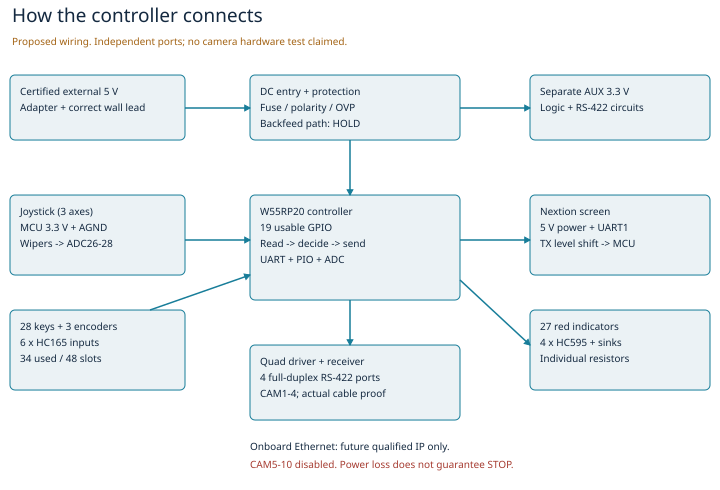

# Church PTZ Camera Controller

A student-built physical controller for the volunteer media team at my church.

**Current working baseline: R6.8, 27 October 2026. Design and bench-development phase. Enclosure/PCB fabrication and complete-build spending remain on HOLD.**

The earlier PC/Python work remains a reference harness. Real control of installed church heads has not been demonstrated by this revision.

## Current operator interface

- 28 pushbuttons: 10 CAM, 12 PRESET, 3 SPEED, AUTO FOCUS, AUTO IRIS and STORE.
- 27 independently red-lit keys, with an unlit STORE acceptable.
- 3 encoders: focus, iris and menu. No physical LOCK.
- ServoCity 605616 spring-return pan/tilt/twist joystick.
- Owned Nextion NX4024T032_011; actual revision, touch capability and viewport need measurement.

The owner preserves and finishes the existing Onshape layout. No current control-centre export or actual CAD screenshot was available for the R6.8 handoff. Generated reference diagrams are labelled as such and are not photos.

## Proposed hardware

W55RP20-EVB-PICO with four independent full-duplex RS-422 ports for CAM1-4. One sample is approved; dispatch/receipt is unconfirmed in the inspected evidence. Onboard Ethernet is for a later separately tested IP profile. CAM5-10 remain disabled. Existing equipment is Datavideo PTR-10/T MARK II with Panasonic AG-CX350 and the RMC-180 MARK II retained as fallback.

A proposed19-pin allocation shares the HC165/HC595 clock and dedicates GP15 to transmitter enable. It uses GP0-15 and GP26-28 only. Six input chips provide two local24-bit banks; four output chips feed27 transistor LED sinks. This is an engineering proposal, not a clean native KiCad release.



Iris, autofocus and other camera functions must remain unavailable until the installed control path proves support. A local lamp or ACK is not proof of camera state or preset arrival. Power loss cannot guarantee remote STOP.

## Start here

- [Independent build manual](docs/r68/Independent_Build_Manual.md)
- [Electrical topology and unresolved decisions](docs/r68/Electrical_Design.md)
- [BOM and acquisition status](docs/r68/BOM_and_Acquisition.csv)
- [Fit and hole HOLD register](docs/r68/Fit_and_Hole_Register.csv)
- [Acceptance and commissioning record](docs/r68/Acceptance_and_Commissioning.md)
- [Support and acknowledgements](docs/SPONSORSHIP_AND_SUPPORT.md)

## Validation

Run from `software` with Python3.10 or newer:

```sh
python3 -m unittest discover -s tests -v
python3 test_controller.py
```

R6.8 host result:17 unit tests passed, including13 new map/safety tests, and the legacy controller assertions passed. [Actual host output](docs/r68/Host_Test_Results.txt). New MicroPython files were syntax-checked only. They were not executed on W55 hardware.

`firmware/r68/diagnostic.py` holds camera-driver enable low. `pio_uart.py` is experimental loopback transport with missing production error handling. Neither is production controller firmware. Legacy Python helpers retain older camera-number/address behaviour; use the new per-port profile model for further development and qualify actual installed addresses.

## Release and funding

No production CAD/PCB release. The old D1 reports recorded7 ERC and3 DRC findings; they were not cleared here. Samples, finish/cutout tests, final board layouts, native ERC/DRC, real-head tests and written manufacturer acceptance are required.

The complete27-key APEM assembly quote is pending. A retail benchmark for27 bare3FTH987 switch bases alone is C$355.05 before caps, bezels, taxes and shipping, exceeding the C$250 personal cap. Do not label the build funded or the BOM finalized. Supported complete keys or an explicitly approved design change is needed.

Historical documents are retained under [docs/history](docs/history). The current R6.8 requirements supersede older34-button/6-encoder/LOCK and W5500-EVB-PICO definitions. Existing PR2 also needs reconciliation before any later merge.
