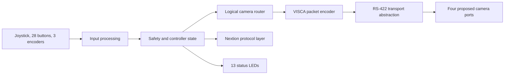

# Church PTZ Camera Controller

An open, student-engineered camera controller for church volunteers, inspired
by the workflow of the Datavideo RMC-180 MARK II. The goal is a clear physical
console for selecting cameras, moving pan/tilt/zoom, recalling shots, and
showing useful status without asking an operator to understand hexadecimal or
serial protocols.

Gbenga began this project in Grade 12 with a Python VISCA packet generator. The
repository now preserves that learning history and adds a testable C++ firmware
core for the planned WIZnet W55RP20-EVB-PICO.

> **Current status:** the firmware core compiles and passes host-side automated
> tests. It has not been compiled with the RP2040 toolchain or connected to a
> camera. RS-422 wiring, serial resources, voltage interfaces, pin allocation,
> and target-camera capabilities still require bench verification. This is not
> production-ready camera-control hardware.

## Planned system

- WIZnet W55RP20-EVB-PICO controller
- ServoCity 605616 three-axis joystick for pan, tilt, and twist zoom
- Nextion NX4024T032_011 touchscreen
- 28 Omron B3F-4050 switches with B32-1310 caps
- three Bourns PEC11R encoders for focus, iris, and menus
- 13 separate red 3 mm status LEDs
- four full-duplex RS-422 camera ports using non-magnetic Amphenol RJHSE5080
  8P8C connectors
- approximately 400 × 230 mm sloped enclosure

Ten camera positions exist on the front-panel concept, but only four physical
RS-422 ports are planned. The software therefore routes logical camera numbers
through a configurable table. The safe default enables CAM 1–4 and rejects CAM
5–10. It does not pretend that ten physical ports exist.



## What works in software

- joystick calibration, filtering, curves, reversal, dead zones, and immediate
  neutral behavior;
- button press/release debounce and quadrature encoder direction;
- slow/medium/fast motion profiles and variable joystick zoom;
- safe startup that requires neutral before accepting movement;
- stop-on-neutral, input timeout, shutdown stop, and transport fault states;
- configurable logical-camera-to-port/address routing;
- VISCA pan/tilt, zoom, presets, focus, iris, and white-balance packet builders;
- capability gates that keep unverified camera functions disabled;
- VISCA ACK, completion, and error response parsing;
- Nextion command framing and touch-event parsing without invented HMI IDs;
- 13-output default LED state model; and
- a warning-clean C++17 host build with 114 core checks.

## Quick start

Run the new firmware-core tests:

```bash
make -C firmware test
```

Run the existing Python learning tests:

```bash
PYTHONPATH=software python3 -m unittest discover -s software/tests -v
PYTHONPATH=software python3 software/test_controller.py
```

The Pico SDK build is described in [Testing](docs/TESTING.md), but requires a
verified W55RP20 board definition, CMake, the Pico SDK, and an Arm compiler.

## Repository map

| Path | Purpose |
|---|---|
| `firmware/` | New C++ core, host tests, and safe commissioning build |
| `software/controller_v1.py` | Preserved newest VS Code-history prototype |
| `software/` | Python learning, simulations, Xbox, and Arduino input tools |
| `docs/` | Requirements, hardware, architecture, protocol, tests, and teaching guide |
| `cad/`, `images/`, `prototypes/` | Existing project workspaces |

Start with [Software Architecture](docs/SOFTWARE_ARCHITECTURE.md), then read
[Wiring](docs/WIRING.md) before making any electrical connection. The
[Remaining Work](docs/REMAINING_WORK.md) checklist is the practical continuation
plan.

## Safety boundary

An 8P8C/RJ45-shaped camera connector is not automatically Ethernet. Do not
connect this controller to installed church equipment until the head model,
operating mode, baud rate, pinout, polarity, common/reference conductor,
termination, bias, protection, and command set are checked on a disconnected
bench setup. Keep the original RMC-180 available as the fallback controller.

## Documentation

- [Hardware](docs/HARDWARE.md)
- [Software architecture](docs/SOFTWARE_ARCHITECTURE.md)
- [Controls](docs/CONTROLS.md)
- [Wiring and interface status](docs/WIRING.md)
- [Protocol](docs/PROTOCOL.md)
- [Testing](docs/TESTING.md)
- [Decisions](docs/DECISIONS.md)
- [Development log](docs/DEVLOG.md)
- [Learning guide](docs/LEARNING_GUIDE.md)
- [Remaining work](docs/REMAINING_WORK.md)
- [Original software assessment](docs/ORIGINAL_SOFTWARE_ASSESSMENT.md)
- [Reference review](docs/REFERENCE_REVIEW.md)
