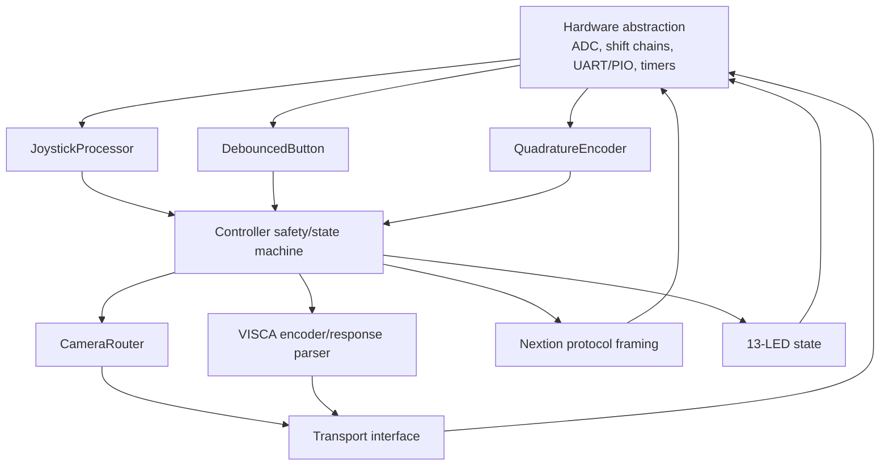
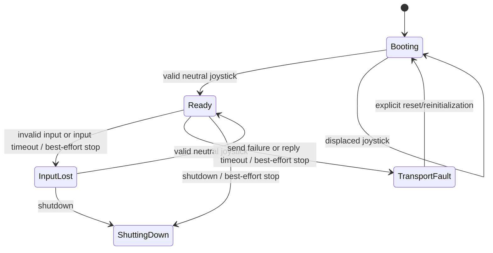

# Software architecture

## Why C++ and the Pico SDK

The W55RP20-EVB-PICO contains an RP2040-class microcontroller and W5500 Ethernet
hardware. WIZnet publishes C/C++, Arduino, and MicroPython examples. All are
possible, but the production direction is C++17 with the Raspberry Pi Pico SDK
because this controller needs:

- direct PIO, UART, ADC, timer, DMA/IRQ, and watchdog access;
- deterministic nonblocking input and serial service;
- explicit memory and startup behavior;
- a path to several concurrent serial interfaces; and
- shared core code that compiles and tests on a computer.

MicroPython remains useful for prototypes, but its W55RP20 support and timing
behavior add risk around five serial links and input scanning. Arduino could
work, but does not remove the PIO/resource problem and adds another abstraction
at the point where board-specific control is most important. The existing
Python is retained for learning, simulation, and command comparison.

## Layered design



The important rule is that a joystick reading never directly toggles a UART
pin. It becomes a normalized intent, passes through safety state, resolves a
logical camera route, becomes a validated protocol packet, and only then reaches
a physical transport.

## Module responsibilities

| Module | Responsibility |
|---|---|
| `types.hpp` | Fixed-capacity packets, speed profiles, capability flags |
| `joystick.*` | Calibration validation, normalization, dead zone, curve, inversion, filtering |
| `inputs.*` | Button press/release debounce, encoder quadrature decoding, 28-button names |
| `router.*` | Map logical CAM 1–10 to enabled physical port, VISCA address, and capabilities |
| `visca.*` | Encode commands and parse ACK/completion/error replies |
| `transport.hpp` | Small physical-send interface used by real and fake transports |
| `controller.*` | Safe startup, state, speeds, movement, stops, presets, lens controls, timeouts, LEDs, diagnostics |
| `nextion.*` | Validate and frame serial commands; parse touch events |
| `pico_main.cpp` | Safe commissioning entry point; physical transmission intentionally disabled |
| `tests/test_main.cpp` | Fake-transport integration tests and unit checks |

## State machine



Startup deliberately emits no movement. A neutral sample arms the controller.
After input loss, only neutral can re-arm it. A transport fault needs explicit
reinitialization so intermittent wiring cannot silently resume motion.

## Motion pipeline

1. The HAL samples three ADC channels and reports whether the input source is
   connected/credible.
2. `JoystickProcessor` maps each calibrated side of center to -1…+1, removes the
   dead zone, applies a curve and optional reversal, then filters noise.
3. A sample inside the dead zone becomes exactly zero immediately. This is a
   safety exception to smoothing so stop is not delayed.
4. `Controller` chooses direction bytes and scales magnitude to the selected
   slow/medium/fast maxima.
5. It sends only changes plus a configurable movement refresh. A 250 ms stale
   input timeout sends stop.
6. `CameraRouter` supplies the physical port, VISCA address, and allowed
   feature set.
7. `visca` validates ranges and constructs a fixed-capacity packet.
8. `Transport` hands it to the future UART/RS-422 HAL. Tests use a fake that
   records packets or injects an error.

## Camera routing

Logical selection is deliberately separate from wire topology:

```text
logical camera -> route table -> physical transport port + VISCA address + capabilities
```

The current safe default is:

| Logical camera | Port | VISCA address | State |
|---:|---:|---:|---|
| 1 | 0 | 1 | enabled |
| 2 | 1 | 1 | enabled |
| 3 | 2 | 1 | enabled |
| 4 | 3 | 1 | enabled |
| 5–10 | none | none | disabled |

Address 1 on each home-run port is a configurable default, not a verified fact
about the installed heads. A future shared bus, switched transceiver bank, or
qualified IP route can change the table without changing joystick logic.

## Capability gating

Pan/tilt, zoom, presets, focus, iris, and white balance are separate flags per
route. Default wired routes enable only pan/tilt, zoom, and presets because the
original prototype and project evidence cover those functions. Focus/iris/WB
packet builders exist for testing, but `Controller` refuses to send them unless
the exact route is explicitly qualified.

## Nextion boundary

No HMI project was found. `nextion.cpp` therefore implements only the reusable
wire boundary:

- validates component identifiers;
- rejects unsafe text that could inject another command;
- emits `.txt=` and `.val=` commands with three `0xFF` terminators; and
- parses the standard seven-byte touch event frame.

A future `NextionLayout`/screen contract should define page and component IDs in
one place after the `.HMI` file exists.

## Work intentionally left in the HAL

The repository does not guess a production pin map. The future HAL must provide:

- timed ADC sampling and disconnect/plausibility evidence;
- 74HC165-family scan chain and bit order;
- encoder sampling/interrupt strategy;
- LED latch/output-enable startup sequence and current-driver control;
- Nextion UART and voltage-interface driver;
- four-port UART/PIO/external-UART implementation;
- bounded RX queues and command transaction/socket tracking per port;
- configuration persistence with version and CRC;
- watchdog enable/feed/recovery; and
- diagnostics over USB/SWD without blocking motion safety.
