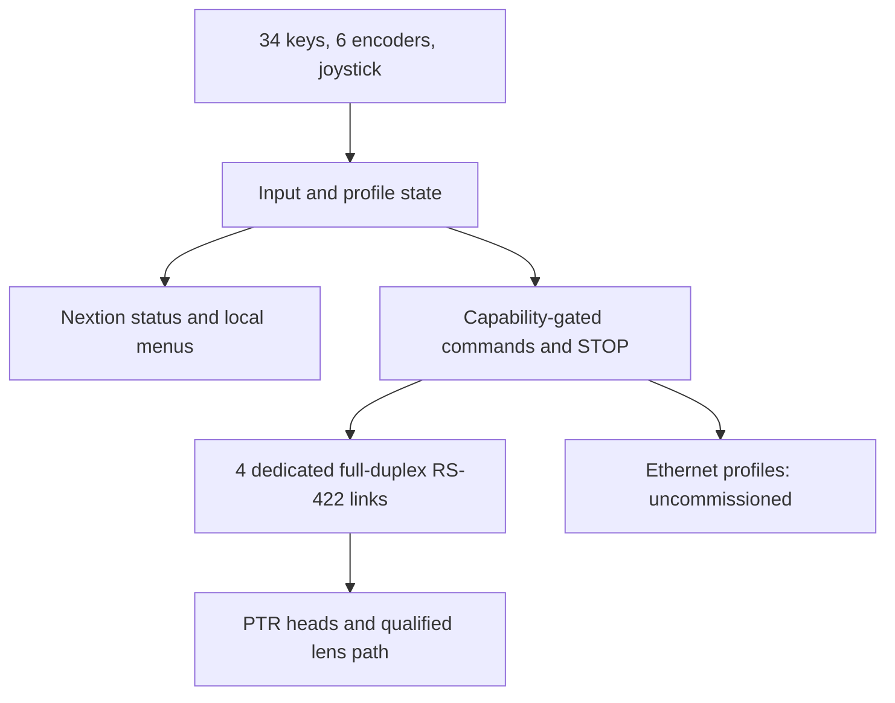

# Current system architecture

This is a design specification, not implemented embedded firmware. [Authoritative decisions](engineering/FINAL_PROJECT_DECISIONS.md).

- CAM1-4 map to physical ports. Profile/device address is distinct from port number. CAM5-10 send nothing until commissioned.
- W55RP20 has19 externally usable GPIO. Six HC165 cover46 input bits; four HC595 provide32 output bits for27 LEDs. Driver and LED enable shareGP15; no routine PWM/blanking on it.
- Ethernet SDK consumes one PIO state machine and two DMA channels. PIO/DMA numbers are static source-review estimates, not a build or coexistence pass.
- Selected CAM LED means selection, not live-program tally. ACK means accepted; qualified arrival is required forREACHED. Timeout/disconnect isUNKNOWN.
- Neutral, LOCK, selection changes and stale input need pan/tilt, zoom and focus STOP plus neutral re-arm. Remote stop on cable/controller power loss is unverified.
- USB/external power, receiver idle, bus protection and ground-reference design remain incomplete. All3D mounting interfaces and physical commissioning remain on hold.

Existing Python packet builders/tests are preserved. Assertions and four unit tests passed in this documentation audit; they simulate commands and do not prove camera operation. [Full verification report](engineering/ENGINEERING_VERIFICATION_REPORT.pdf).
