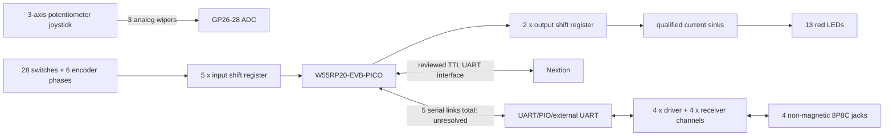

# Wiring and electrical interface register

**No production pin map is released.** This file separates known intent from
proposals and blockers so a drawing is not mistaken for verified wiring.

## Interface-level proposal

| Interface | Proposed connection | Status / required proof |
|---|---|---|
| Joystick pan | wiper to GP26/ADC0 | Proposed; measure terminal map and voltage range |
| Joystick tilt | wiper to GP27/ADC1 | Proposed; measure direction and center |
| Joystick twist | wiper to GP28/ADC2 | Proposed; measure direction and center |
| Joystick rails | 3.3 V reference domain and AGND | Proposed; verify potentiometer topology and filtering |
| 34 contact inputs | five-device parallel-in/serial-out chain | Required architecture; exact IC/family/bit order TBD |
| 13 LEDs | two-device serial output chain plus current sinks | Required architecture; exact drivers/resistors/OE TBD |
| Nextion | one TX/RX serial link plus reviewed level interface | Blocked by `_011` electrical verification |
| Camera ports | four full-duplex TX/RX logic links to RS-422 drivers/receivers | Blocked by UART/PIO architecture and pinout |
| USB/SWD | service/programming access | Must remain accessible in enclosure |
| RUN/BOOTSEL | reset/recovery access | Mechanical/electrical method TBD |

Do not copy a Raspberry Pi Pico example pin map onto this board. WIZnet marks
GPIO17 and GPIO20–25 unavailable and uses GPIO16/18/19/29 for board functions.

## Proposed block wiring

## RS-422 port record

Do not assign 8P8C contact numbers yet. For each of four identical ports the
final table must identify:

| Signal | Contact | Direction at controller | Polarity | Evidence |
|---|---:|---|---|---|
| Controller TX pair | TBD | output | TX+/TX− TBD | continuity + exact head/controller manual |
| Controller RX pair | TBD | input | RX+/RX− TBD | continuity + exact head/controller manual |
| Common/reference | TBD | reference | TBD | system grounding review |
| Shield/chassis | TBD | chassis | TBD | cable and enclosure review |
| Unused/reserved | TBD | none | n/a | exact product pinout |

An RS-422 link is normally full duplex here: one differential pair transmits
commands and another carries replies. Termination belongs at the receiving end
when required by the actual interface. Bias/failsafe values cannot be selected
until receiver behavior, termination, cable load, and the head's existing bias
are known.

## Input scan chain release checklist

1. Choose the exact 3.3 V-compatible input IC and Schmitt strategy.
2. Assign all 40 bits in one documented order: 28 buttons, six encoder phases,
   and six spare/diagnostic positions.
3. Define active-high/active-low electrical meaning and pull resistors.
4. Prove power-up state when MCU pins are high impedance.
5. Scan at a measured rate that preserves encoder edges under maximum serial and
   display traffic; approximately 1 kHz is only a starting experiment.
6. Test every simultaneous button pair required by the control design.

## LED chain release checklist

1. Confirm the 13-indicator functional mapping.
2. Select exact LED MPN and measure forward voltage/brightness at candidate
   currents.
3. Calculate one resistor per LED for the actual rail and sink voltage.
4. Select sink devices/driver IC using total current and thermal limits.
5. Hold outputs disabled with hardware pulls, shift zeroes, latch zeroes, then
   enable. Verify no flash during reset, programming, or brownout.
6. Check brightness through the real panel/cap/light-pipe geometry.

## Power topology gates

- exact external adapter voltage/current/certification;
- panel inlet and polarity;
- whole-unit fuse/current limiting;
- reverse-polarity and USB/DC backfeed protection;
- display branch protection and startup current;
- 5 V and 3.3 V worst-case budget including RS-422 termination load and LEDs;
- decoupling at every IC and connector;
- chassis/shield/logic-ground plan;
- brownout and power-removal behavior; and
- test points for rails, UART logic, scan clocks, resets, and ground.

## First electrical tests

Use a current-limited bench supply and no church equipment:

1. continuity and short check with power off;
2. power rail voltage/current with MCU removed where practical;
3. MCU only, then display, inputs, LEDs, and transceivers one subsystem at a
   time;
4. UART logic-level loopback before RS-422;
5. RS-422 controller-side loopback through a known-good test fixture;
6. failsafe/idle and unplug/replug tests;
7. one supervised PTR head at minimum speed only after every preceding gate.
